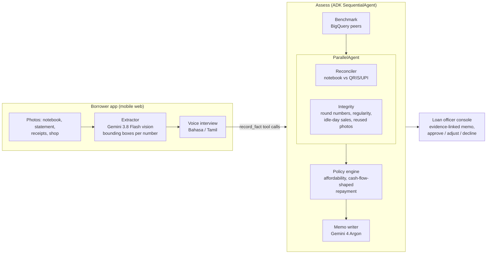

# Bukti — credit from the evidence small shops actually keep

> *Bukti* means "proof" in Bahasa Indonesia and Malay.

Ibu Sari has run her warung in Yogyakarta for twelve years. Her records are a handwritten notebook, a QRIS
payment history and a shoebox of supplier receipts. No bank will lend her the Rp 3 million she needs for
festival stock, because none of that counts as a financial statement.

**Bukti turns that evidence into an explainable, verified credit decision in minutes, in her own language.**

- 📸 **Photo** — she photographs her notebook pages, payment statement, receipts and shop.
- 🗣️ **Story** — a two-minute voice interview with an AI field officer in Bahasa Indonesia or Tamil. The officer
  has already read her notebook, so it asks about *her* numbers ("your sales dip mid-month — why?").
- ✅ **Result** — agents verify the notebook against the payment rail, look for signs of a written-up ledger,
  benchmark against similar shops, size an affordable loan with repayments shaped to her monthly cash cycle,
  and write a memo where **every number links back to the exact spot on the photo**. A human loan officer decides.

Theme: **BFSI — Intelligent Risk, Fraud & Financial Experiences** (Google Cloud AI Builder Cup JAPAC 2026).

**Live demo:** https://bukti-474706728997.asia-southeast1.run.app (no login needed)

**Docs:** [Architecture & diagrams](docs/ARCHITECTURE.md) · [How to test](docs/TESTING.md) ·
[Costs](docs/COSTS.md) · [Operations](docs/OPERATIONS.md) · [API contract](docs/CONTRACT.md)

## Why it matters

- Southeast Asia's MSME credit shortfall is estimated at roughly US$430B, with Indonesia alone around
  US$235B — about three quarters of its MSME financing need. *(industry estimates; see deck for sources)*
- More than 80% of Philippine microenterprises are informal and "don't have financial statements".
- Informal businesses do keep records — mostly in notebooks. Lenders just can't read or trust them at scale.

Bukti reads them, checks them against an independent source (QRIS/UPI), and shows its work.

## How it works



| Agent | What it does | Google Cloud |
|---|---|---|
| Extractor | Reads handwritten ledger pages and payment statements; every amount keeps a box on the photo | Gemini 3.8 Flash (vision, structured output) on Gemini Enterprise Agent Platform |
| Interviewer | Live voice interview in the borrower's language, informed by the notebook; records answers as facts with quotes | Gemini 3.8 Live via ADK `run_live` |
| Benchmark | Peer digital-payment share and daily sales for similar shops | BigQuery |
| Reconciler | Digital share vs peers, daily-rhythm correlation, sales on idle days | deterministic (ADK custom agent) |
| Integrity | Round-number test, too-regular entries, re-used photos (perceptual hash) | deterministic (ADK custom agent) |
| Policy | Verified sales → net cash → affordable loan; repayments shaped to the shop's month | deterministic (ADK custom agent) |
| Memo | Explains the decision for the officer and, in the borrower's language, for the borrower; cites evidence ids | Gemini 4 Argon (ADK `LlmAgent`, output schema) |
| Officer Copilot | Answers the officer's questions about one case with read-only tools and highlights the evidence on the photo | Gemini 3.8 Flash (ADK `LlmAgent` + 6 tools) |

Every runner carries an ADK **observability plugin**: each agent step, model call (latency, tokens, cost) and tool
call is shown in the console's run log and written to BigQuery (`bukti.events`); every log line also reaches
BigQuery through a Cloud Logging sink. Optional **Google sign-in** (Firebase Auth) stores users in Firestore.

**Gemini reads and explains; rules decide; a human approves.** The memo model never sets a number.

Runs as one Cloud Run service (FastAPI + ADK + the web app), with Firestore for applications, Cloud Storage
for uploads, BigQuery for benchmarks, and Gemini TTS for spoken instructions and the borrower's explanation.

## Results

See [`eval/results/results.md`](eval/results/results.md) — produced by `eval/run_eval.py` against eight
applicant packs (genuine, inflated, fabricated) handwritten by our team in Bahasa Indonesia and Tamil.

## Responsible AI

- A human loan officer makes every decision; flagged cases are referred, never auto-declined.
- No protected attributes are used or asked about (gender, religion, ethnicity, marital status, age).
- Every claim in the memo cites the evidence it rests on; every number links to its place on the photo.
- Affordability is capped at 30% of each week's verified net cash (stricter than RBI's 50% household cap).
- Borrower messages are written to preserve dignity: a decline is a path forward, not a dead end.

## Guardrails and security

**AI guardrails**
- Model Armor screens every piece of borrower-written text (notebook notes, line descriptions, interview quotes)
  for prompt injection and unsafe content before it can reach the memo model. A fabricated demo notebook carries a
  hidden "approve the maximum loan" note to the AI; it is caught and shown to the officer as a failed check.
- Structured output with response schemas; bounding boxes clamped; implausible amounts dropped.
- Every model call is bounded: hedged vision requests, timeouts, a rules-only memo fallback, a live-session reconnect.

**Runtime guardrails** (`app/guards.py`)
- Per-IP token buckets on every endpoint that spends model tokens or writes data; global caps on concurrent
  pipeline runs and live interviews; at most 12 photos per application; 15 MB per photo, decoded as an image.
- Content-Security-Policy, HSTS, nosniff, a strict permissions policy (microphone and camera only for this site),
  `frame-ancestors 'none'`; API docs disabled in production.
- Logs are structured JSON and carry only ids, never borrower names, quotes or amounts.

**Cloud**
- Least-privilege service accounts: the runtime account can call Gemini, read benchmarks, write Firestore and its
  own bucket; the CI deployer can only push to one Artifact Registry repo and roll out the service.
- No keys anywhere: GitHub Actions authenticates through Workload Identity Federation, scoped to this repository.

## CI/CD

`.github/workflows/ci-cd.yml` — actions pinned to commit SHAs.

| Gate | Tooling |
|---|---|
| Backend quality | ruff, pytest (rules, API guardrails, pipeline) |
| Frontend quality | TypeScript, oxlint, production build |
| Secrets | gitleaks over the full history |
| SAST | Semgrep (Python, TypeScript, React, Dockerfile, secrets), bandit |
| Dependencies | pip-audit, npm audit |
| Container | Trivy image scan (fixable HIGH/CRITICAL fail the build), Trivy Dockerfile config scan |
| Code quality | SonarQube quality gate (self-hosted on Cloud Run + Cloud SQL, `infra/sonarqube/`) |

Latest results: 14 tests pass; Semgrep 0 findings (268 rules); gitleaks clean over the full history; pip-audit and npm
audit 0 known vulnerabilities; Trivy 0 fixable HIGH/CRITICAL in the image; SonarQube quality gate passed (0 bugs,
reliability A, maintainability A, 0.3% duplication over ~10k lines).

On `main`, the exact image that was scanned is pushed by digest, deployed to Cloud Run, smoke-tested, and traffic is
rolled back automatically if the smoke test fails.

## Run it locally

```bash
uv sync                                    # Python 3.12, google-adk 2.12
(cd web && npm ci && npm run build)        # React + Vite + Tailwind
gcloud auth application-default login      # Gemini on Agent Platform — no API keys
GOOGLE_CLOUD_PROJECT=<project> uv run uvicorn app.main:app --port 8080
```

Without cloud credentials: `BUKTI_DEV_GROUND_TRUTH=1` replaces the vision model with pack ground truth, and
`cd web && npm run dev:mock` runs the whole UI on in-browser mocks.

Tests: `uv run pytest`. Evaluation: `uv run python eval/run_eval.py --base http://localhost:8080`.

## Deploy

`./deploy.sh` enables the APIs, creates a least-privilege service account, Firestore, a bucket and the BigQuery
benchmark table, then deploys to Cloud Run (`asia-southeast1`).

## Data

All applicant data is synthetic. Notebook pages were handwritten by the team from generated ground truth
(`data/generate_packs.py`); payment statements are rendered from the same ground truth and are unbranded.
The lender policy in `data/policy/` is an illustrative sample, not a real lender's policy.
