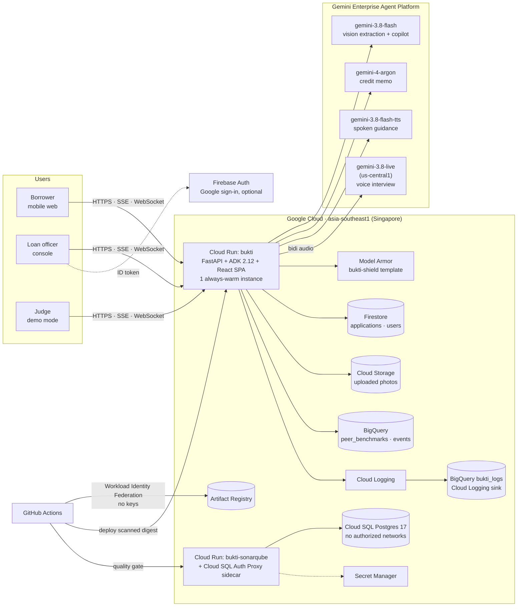
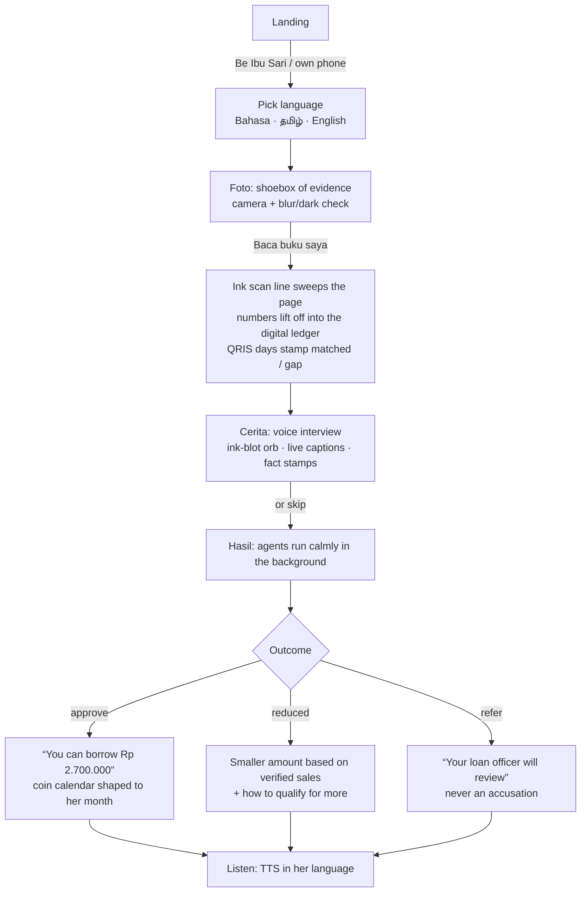
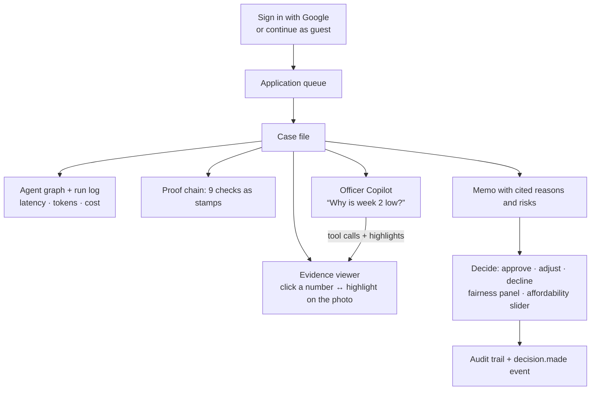
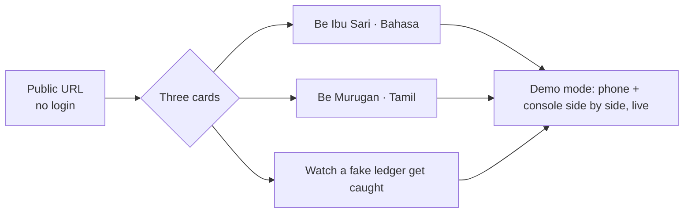
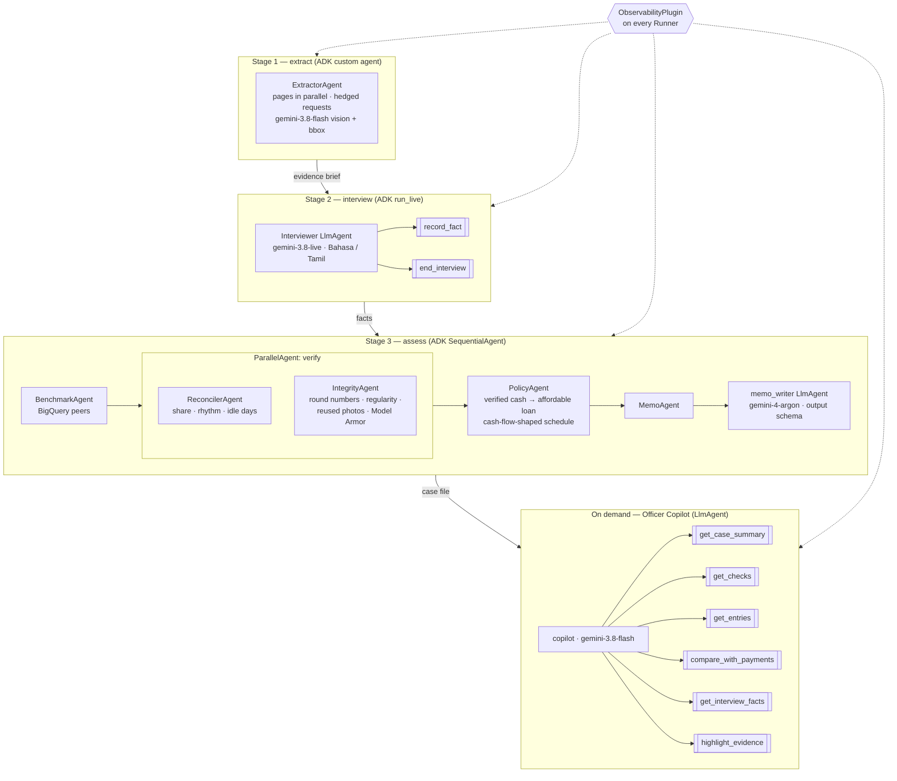
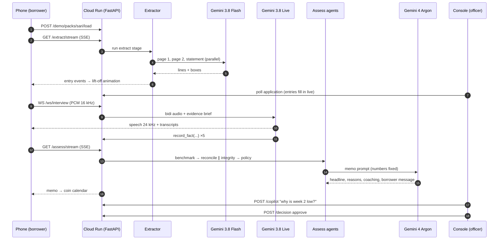
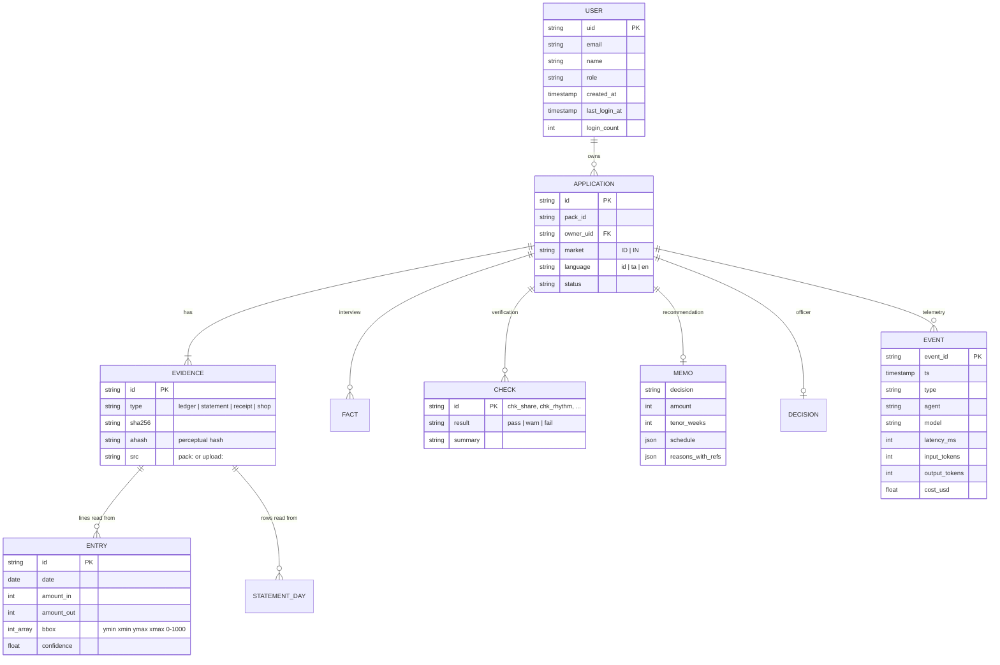
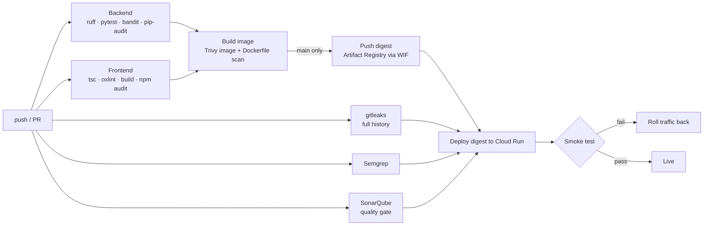

# Bukti — architecture

> Evidence-based credit for informal micro-businesses. Google Cloud AI Builder Cup JAPAC 2026, BFSI theme.
> Companion docs: [TESTING.md](TESTING.md) · [COSTS.md](COSTS.md) · [OPERATIONS.md](OPERATIONS.md) ·
> [CONTRACT.md](CONTRACT.md) (API) · [PITCH.md](PITCH.md) (video + deck)

## 1. What it does

A warung owner in Indonesia or a kirana owner in Tamil Nadu has years of business records — in a handwritten
notebook, a QRIS/UPI payment history and a shoebox of receipts — but no financial statements, so banks can't lend.

Bukti turns that evidence into an explainable credit decision:

1. **Photo (Foto).** The borrower photographs notebook pages and their payment statement. Gemini 3.8 Flash reads
   every line; each number keeps a bounding box back to where it was written.
2. **Story (Cerita).** A two-minute voice interview in Bahasa Indonesia or Tamil with Gemini 3.8 Live. The
   interviewer has already read the notebook, so it asks about *their* numbers.
3. **Result (Hasil).** ADK agents benchmark the shop against peers (BigQuery), reconcile the notebook against the
   payment rail, test for fabrication (including Model Armor screening of hidden instructions to the AI), size an
   affordable loan with repayments shaped to the shop's month, and Gemini 4 Argon writes the memo.
4. **Decision.** A loan officer reviews an evidence-linked memo, asks the **Officer Copilot** questions, and
   approves, adjusts or declines. The borrower hears the outcome in their own language.

Principle: **Gemini reads and explains; rules decide; a human approves.**

## 2. GCP architecture



| Component | Why it is there |
|---|---|
| Cloud Run `bukti` | One service serves the web app, REST, SSE streams and the interview WebSocket. `min-instances=1` so judges never hit a cold start; `max-instances=1` keeps in-memory state consistent; session affinity for WebSockets. |
| Gemini 3.8 Flash | Reads handwriting and statements with structured output + bounding boxes; powers the Officer Copilot. |
| Gemini 4 Argon | Writes the officer memo and the borrower message from the policy engine's numbers. |
| Gemini 3.8 Live | Native-audio interview in Bahasa / Tamil with tool calls. Only served from US regions. |
| Gemini 3.8 Flash TTS | Speaks instructions and the outcome to low-literacy borrowers. |
| Model Armor | Prompt-injection / jailbreak and safety screening of all borrower-written text and copilot questions. |
| Firestore | Applications (write-through from memory) and the `users` table. |
| BigQuery | `peer_benchmarks` (policy input), `events` (typed audit + agent telemetry), `bukti_logs` (every log line). |
| Firebase Auth | Optional Google sign-in; the demo never requires it. |
| Artifact Registry + GitHub Actions | CI builds, scans, pushes and deploys by digest. |
| SonarQube on Cloud Run + Cloud SQL | Self-hosted code-quality gate; scales to zero; DB only reachable through the IAM-authenticated proxy. |

## 3. User flows

### Borrower (mobile)



### Loan officer (desktop)



### Judge



## 4. Agent architecture



| Agent | Type | Model | Decides or explains | Guardrails |
|---|---|---|---|---|
| Extractor | `BaseAgent` (custom) | gemini-3.8-flash | Reads | response schema, bbox clamp, implausible-amount drop, 60 s timeout + hedge, cache by image hash |
| Interviewer | `LlmAgent` (live) | gemini-3.8-live | Asks | no protected attributes, never promises a loan, 5-min cap, reconnect once, quotes only reach the memo after Model Armor |
| Benchmark | `BaseAgent` | — (BigQuery) | Decides input | validated identifiers, parameterised query, cached |
| Reconciler | `BaseAgent` | — | **Decides** | deterministic, unit-tested on ground truth |
| Integrity | `BaseAgent` | — + Model Armor | **Decides** | screens notes, descriptions, quotes |
| Policy | `BaseAgent` | — | **Decides** | 30% weekly affordability cap, first-loan caps, refer on ≥2 integrity failures |
| Memo writer | `LlmAgent` | gemini-4-argon | Explains | output schema, never sets numbers, 120 s timeout → rules-only memo |
| Officer Copilot | `LlmAgent` + 6 tools | gemini-3.8-flash | Explains | read-only tools scoped to one case, Model Armor on questions, 90 s timeout |

Why this split: credit decisions must be reproducible and auditable, so every number and every verdict comes from
deterministic agents that are unit-tested against ground truth. LLMs do what they are uniquely good at — reading
messy handwriting, interviewing in local languages, and explaining — and are bounded by schemas, timeouts and
guardrails. ADK gives one runtime for all of it (custom agents, sequential/parallel orchestration, live audio,
tool-using agents) and a single plugin point for observability.

### One application end to end



## 5. Data model



Where it lives: `APPLICATION` and children → Firestore `applications/{id}` (one document); `USER` → Firestore
`users/{uid}`; `EVENT` → BigQuery `bukti.events` (partitioned by day, clustered by type and application); every log
line → BigQuery `bukti_logs` via a Cloud Logging sink; benchmarks → BigQuery `bukti.peer_benchmarks`; uploaded
photos → `gs://bukti-ai-evidence/uploads/`.

## 6. Security and guardrails

```mermaid
flowchart LR
  IN[Request] --> RL[Per-IP token buckets<br/>+ concurrency caps]
  RL --> AUTH[Optional Firebase ID token<br/>verified against Google keys]
  AUTH --> VAL[Validation<br/>image decode · 15 MB · 12 photos · enums]
  VAL --> MA[Model Armor<br/>borrower text + copilot questions]
  MA --> LLM[Gemini<br/>schemas · timeouts · hedges · fallbacks]
  LLM --> RULES[Deterministic policy<br/>sets every number]
  RULES --> HUMAN[Human officer decides]
  HUMAN --> OUT[Response<br/>CSP · HSTS · nosniff · COOP]
```



- **Identity & access.** Runtime SA: Agent Platform user, Firestore user, BigQuery job user + dataset-level writer on
  `bukti` only, read on benchmarks, its own bucket, Model Armor user. CI deployer SA: push to one Artifact Registry
  repo, `run.developer`, act-as the runtime SA — via WIF scoped to `AgentsBakery/Bukti`, no keys. SonarQube SA: Cloud
  SQL client + its own DB secret.
- **Public access** uses Cloud Run's `--no-invoker-iam-check` because the organisation enforces domain-restricted
  sharing; the org policy is untouched.
- **Data.** All synthetic. Logs carry ids, never names, quotes or amounts. Firestore, GCS, BigQuery and Cloud SQL are
  in asia-southeast1; model calls go to Agent Platform's global endpoint (Live: us-central1).
- **Responsible AI.** No protected attributes are used or asked; flagged cases are referred, not auto-declined;
  borrower messages are dignity-first; every reason cites evidence.

## 7. CI/CD



## 8. Observability

- **Run log in the console**: every agent start/finish, model call (model, latency, input/output tokens, cost), tool
  call, guardrail block and decision for the selected application.
- **BigQuery `bukti.events`**, e.g. cost per application:

```sql
SELECT app_id, ROUND(SUM(cost_usd), 4) AS usd, SUM(input_tokens + output_tokens) AS tokens,
       COUNTIF(type = 'guardrail.blocked') AS blocked
FROM `bukti-ai.bukti.events`
WHERE ts > TIMESTAMP_SUB(CURRENT_TIMESTAMP(), INTERVAL 7 DAY)
GROUP BY app_id ORDER BY usd DESC;
```

- **BigQuery `bukti_logs`**: every structured log line from the service (Cloud Logging sink), for incident review.

## 9. Repository map

| Path | What |
|---|---|
| `app/main.py` | FastAPI routes, SSE stages, interview WebSocket, TTS, SPA serving |
| `app/guards.py` | Rate limits, concurrency caps, security headers |
| `app/auth.py` | Optional Firebase sign-in, `users` table |
| `app/telemetry.py` | Events, cost estimates, BigQuery writer |
| `app/store.py`, `app/packs.py` | Applications, evidence images, demo packs |
| `agents/extractor.py` | Vision extraction agent |
| `agents/assess.py`, `agents/analysis.py` | Benchmark, reconcile, integrity, policy, memo |
| `agents/interviewer.py` | Live voice interviewer |
| `agents/copilot.py` | Officer Copilot |
| `agents/observability.py` | ADK plugin |
| `agents/shield.py` | Model Armor client |
| `web/` | React + Vite + Tailwind app (borrower, console, demo, login) |
| `data/` | Pack generator, packs, policy, benchmarks, bundled reads |
| `eval/` | End-to-end eval, interview smoke test, cache bundler |
| `infra/sonarqube/` | SonarQube image, Cloud Run service, deploy script |
| `.github/workflows/ci-cd.yml` | Pipeline |

## 10. Built so far (chronological)

| Commit | Milestone |
|---|---|
| `f299445` | Evidence packs, ADK pipeline and API |
| `6e17b60` | Deploy script, Dockerfile, eval harness, policy, README |
| `e1f663c` | Verified live on bukti-ai: warm-up, timeouts, interview smoke test |
| `968a2ea` | Hedged vision calls, live reconnect, cached benchmarks, public access |
| `6b89062` | Model Armor screening of borrower text |
| `111ba5b` | Pitch kit, legible scan pacing |
| `282d3f5` | Ink & Paper web app; ruff/bandit/Semgrep fixes |
| `1b5e664` | CI/CD with security gates, WIF deploys, runtime guardrails |
| `a17eb9b` | SonarQube on Cloud Run + Cloud SQL |
| `9b54e81` | Fixes for findings raised by the pipeline's own gates |
| `84cd5e7` | Officer Copilot, observability plugin, optional sign-in, events and log tables |

## 11. Known limitations

- Demo data is synthetic; accuracy numbers come from team-handwritten pages, not real borrowers.
- One Cloud Run instance by design (in-memory sessions); scaling out needs Agent Platform Sessions for ADK and
  Firestore-only reads.
- The officer console is open to guests in the demo; production would require sign-in and roles for officers.
- Live interview runs in us-central1 (the only Live region), so audio crosses regions.
- Sign-in requires the Google provider to be enabled in Firebase (see OPERATIONS.md).
